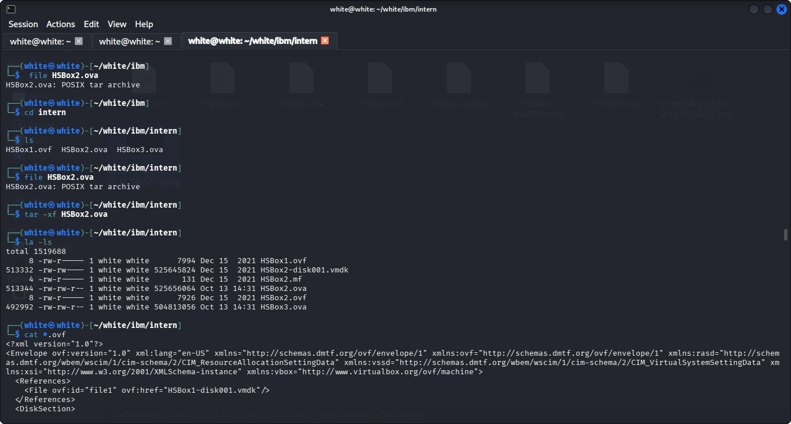
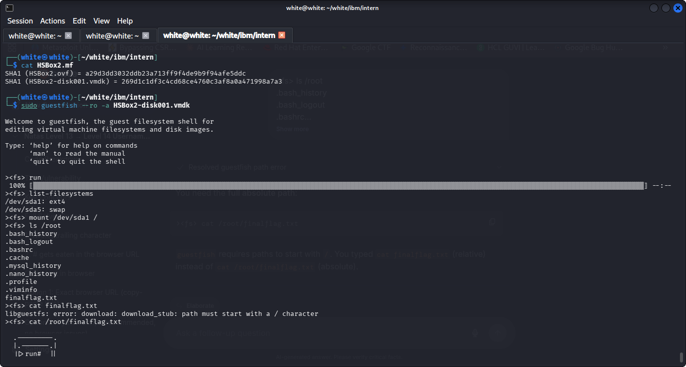
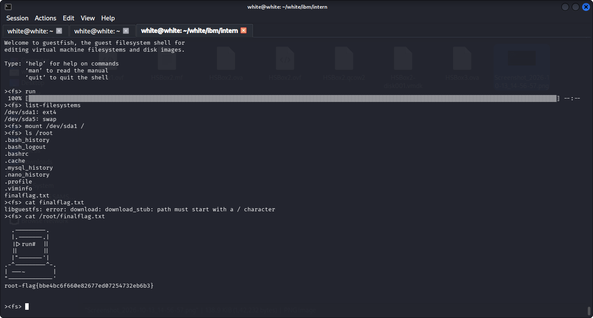

# VM Forensics & Offline Disk Analysis Report: HSBox2

**Analyst / Intern:** white  
**Target Appliance:** HSBox2.ova (`HSBox2-disk001.vmdk`)  
**Methodology:** Dead-Box / Offline Disk Forensics via `libguestfs` (`guestfish`)  
**Status:** Completed & Flag Retrieved  

---

## 1. Executive Summary & Objective

In this forensics lab, the objective was to perform offline forensics on a suspicious virtual appliance (`HSBox2.ova`) without booting the virtual machine. Booting an untrusted or compromised VM can contaminate volatile evidence, trigger malware execution, alter timestamps, or modify logs.

By utilizing **dead-box forensic analysis** with `guestfish`, we extracted the underlying virtual disk (`.vmdk`), mounted its partitions in a secure read-only environment, recovered the root flag, and analyzed attacker/administrator activity through shell and database history logs.

---

## 2. Tools & Utilities

| Tool | Purpose | Key Flags Used |
| :--- | :--- | :--- |
| `file` | Identifies file types and container packaging formats | Default |
| `tar` | Unpacks POSIX tar archives (.ova packages) | `-xf` (extract file) |
| `guestfish` | Libguestfs interactive shell for inspecting VM disk images | `--ro` (read-only), `-a` (add disk) |
| `cat` / `ls` | Standard inspection inside guestfish virtual filesystem | Absolute paths required (`/root/...`) |

---

## 3. Step-by-Step Walkthrough

### Step 1: Appliance Inspection & OVA Extraction

An `.ova` (Open Virtual Appliance) package is structured as a standard POSIX tar archive containing disk images and configuration descriptors.

1. **Verify file format:**
   ```bash
   file HSBox2.ova
   # Output: HSBox2.ova: POSIX tar archive
   ```

2. **Extract OVA archive:**
   ```bash
   tar -xf HSBox2.ova
   ```

3. **Verify extracted components:**
   ```bash
   ls -la
   ```
   * `HSBox2.ovf`: XML descriptor containing VM hardware configuration and disk mapping.
   * `HSBox2.mf`: Manifest file holding SHA-1 cryptographic hashes of the disk and configuration files.
   * `HSBox2-disk001.vmdk`: The actual virtual disk image (size ~501 MB).

4. **Review Manifest Hashes:**
   ```bash
   cat HSBox2.mf
   # SHA1 (HSBox2.ovf) = a29d3dd3032ddb23a713ff9f4de9b9f94afe5ddc
   # SHA1 (HSBox2-disk001.vmdk) = 269d1c1df3c4cd68ce4760c3af8a0a471998a7a3
   ```



---

### Step 2: Initializing Safe Read-Only Analysis with Guestfish

To maintain cryptographic and forensic integrity, the disk image was attached using `guestfish` in **read-only mode (`--ro`)**.

1. **Launch Guestfish in Read-Only Mode:**
   ```bash
   sudo guestfish --ro -a HSBox2-disk001.vmdk
   ```
   > **Note:** Sudo is required because `libguestfs` spawns a sandboxed QEMU hypervisor instance in the background.

2. **Start the Appliance Backend:**
   ```bash
   ><fs> run
   ```
   This initializes the QEMU backend and scans disk partitions.

3. **Inspect Detected Filesystems:**
   ```bash
   ><fs> list-filesystems
   ```
   **Output:**
   * `/dev/sda1: ext4` (Root filesystem)
   * `/dev/sda5: swap` (Swap partition)

4. **Mount Partition to Virtual Root:**
   ```bash
   ><fs> mount /dev/sda1 /
   ```
   The root partition is now accessible through guestfish's internal commands.



---

### Step 3: Root Directory Navigation & Flag Extraction

1. **Directory Listing:**
   ```bash
   ><fs> ls /root
   ```
   Files found in `/root`:
   * `.bash_history`
   * `.bash_logout`
   * `.bashrc`
   * `.cache`
   * `.mysql_history`
   * `.nano_history`
   * `.profile`
   * `.viminfo`
   * `finalflag.txt`

2. **Path Syntax Note:**
   Attempting `cat finalflag.txt` triggers an error:
   ```text
   libguestfs: error: download: download_stub: path must start with a / character
   ```
   *Resolution:* Guestfish commands require full absolute paths starting with `/`.

3. **Displaying the Flag:**
   ```bash
   ><fs> cat /root/finalflag.txt
   ```

   **Output:**
   ```text
     .---------.
     |.-------.|
     ||>run#  ||
     ||       ||
     |"-------'|
   .-^---------^-.
   | ---~        |
   "-------------'
   root-flag{bbe4bc6f660e82677ed07254732eb6b3}
   ```



---

## 4. Post-Extraction Forensic Findings

Beyond capturing the flag, forensic examination of root history logs revealed critical indicators of compromise and system configuration:

### 4.1 Anti-Forensics & Log Tampering (`.bash_history`)
```bash
><fs> cat /root/.bash_history
```
**Contents:**
```bash
ls
truncate -s 0 /var/log/syslog 
truncate -s 0 /var/log/*log
truncate -s 0 /var/log/apache2/*log
ls -la
rm .bash_history 
cat .bash_logout 
passwd
reboot
```
* **Analysis:**
  * The user/attacker actively attempted **log clearing (anti-forensics)** by truncating `/var/log/syslog`, wildcard system logs `/var/log/*log`, and Apache web server access/error logs `/var/log/apache2/*log` to 0 bytes.
  * They attempted to delete `.bash_history` and modify the root password (`passwd`) prior to rebooting.
  * Because `guestfish` inspects unallocated blocks and existing inodes offline, residual history and files remained recoverable.

### 4.2 Database Credential Discovery (`.mysql_history`)
```bash
><fs> cat /root/.mysql_history
```
**Contents:**
```sql
CREATE DATABASE pumpkins;
CREATE USER admin@localhost IDENTIFIED BY 'admin@123';
GRANT ALL PRIVILEGES ON pumpkins.* TO admin@localhost;
FLUSH PRIVILEGES;
```
* **Analysis:**
  * A MySQL database named `pumpkins` was provisioned.
  * A local user `admin@localhost` was granted full privileges with plaintext password: `admin@123`.

---

## 5. Command Reference & Cheat Sheet

| Action | Command |
| :--- | :--- |
| Open disk image (Read-Only) | `sudo guestfish --ro -a <disk.vmdk>` |
| Initialize backend appliance | `><fs> run` |
| View partitions & file systems | `><fs> list-filesystems` |
| Mount partition to root | `><fs> mount /dev/sda1 /` |
| List files inside directory | `><fs> ls /root` |
| View file contents (Absolute path) | `><fs> cat /root/<file>` |
| Download file to host workstation | `><fs> download /root/<file> /path/on/host` |
| Exit and close session | `><fs> exit` |

---

## 6. Flag Verification

| Artifact | Extracted Value |
| :--- | :--- |
| **Root Flag** | `root-flag{bbe4bc6f660e82677ed07254732eb6b3}` |
| **MySQL Database** | `pumpkins` |
| **MySQL Credentials** | `admin` : `admin@123` |
