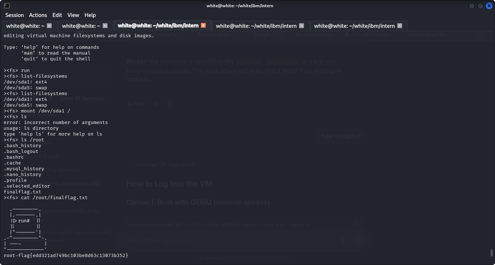

# VM Forensics & Offline Disk Analysis Report: HSBox3

**Analyst / Intern:** white  
**Target Appliance:** HSBox3.ova (`HSBox3-disk001.vmdk`)  
**Methodology:** Dead-Box / Offline Disk Forensics via `libguestfs` (`guestfish`)  
**Status:** Completed & Flag Retrieved  

---

## 1. Executive Summary & Objective

In this forensics lab, we conducted dead-box forensics on the virtual appliance `HSBox3.ova`. Following forensic integrity protocols, the target virtual disk (`HSBox3-disk001.vmdk`) was analyzed completely offline in read-only mode using `guestfish` to prevent evidence spoliation.

The investigation successfully:
1. Extracted and verified the VMDK disk image from the OVA container.
2. Mounted the ext4 root partition offline without booting the operating system.
3. Extracted the root flag from `/root/finalflag.txt`.
4. Analyzed anti-forensics sanitization techniques (`zerofree` in `.bash_history`).
5. Recovered database migration trails and administrative credentials in `.mysql_history`.
6. Extracted `/etc/shadow` for offline credential cracking.

---

## 2. Tools & Utilities

| Tool | Purpose | Key Flags Used |
| :--- | :--- | :--- |
| `guestfish` | Libguestfs interactive shell for dead-box VM analysis | `--ro` (read-only), `-a` (add disk) |
| `list-filesystems` | Discovers partitions and filesystem formats | Default |
| `mount` | Mounts guest filesystem to virtual root | `mount <partition> <mountpoint>` |
| `cat` / `ls` | Explores internal filesystem using absolute paths | `cat /path/to/file` |
| `download` | Extracts evidence files from the VM disk to host workstation | `download <remote_path> <host_path>` |

---

## 3. Step-by-Step Walkthrough

### Step 1: Disk Inspection & Guestfish Initialization

1. **Verify Disk & Manifest Hashes:**
   ```bash
   cat HSBox3.mf
   # SHA1 (HSBox3-disk001.vmdk) = 4e468f030a3264dc7f0b4e70eaba499731e5870d
   # SHA1 (HSBox3.ovf) = e1580341363fc5ef5c57f1ed4ce2e04768028d9e
   ```

2. **Launch Guestfish in Read-Only Mode:**
   ```bash
   sudo guestfish --ro -a HSBox3-disk001.vmdk
   ```
   > **Forensic Protocol:** The `--ro` flag guarantees that no block on the target disk is modified, maintaining hash integrity.

3. **Initialize Appliance Backend & Detect Partitions:**
   ```text
   ><fs> run
   ><fs> list-filesystems
   /dev/sda1: ext4
   /dev/sda5: swap
   ```

4. **Mount Partition to Virtual Root:**
   ```text
   ><fs> mount /dev/sda1 /
   ```

5. **Directory Listing (`/root`):**
   ```text
   ><fs> ls /root
   .bash_history
   .bash_logout
   .bashrc
   .cache
   .mysql_history
   .nano_history
   .profile
   .selected_editor
   finalflag.txt
   ```
   *(Note: Running `ls` without arguments returns `error: incorrect number of arguments`. In guestfish, `ls` requires an explicit directory path like `ls /root`.)*

---

### Step 2: Root Flag Retrieval

Reading the flag using the absolute path `/root/finalflag.txt`:

```text
><fs> cat /root/finalflag.txt

  .---------.
  |.-------.|
  ||>run#  ||
  ||       ||
  |"-------'|
.-^---------^-.
| ---~        |
"-------------'
root-flag{edd321ad749bc103be8d63c13073b352}
```



---

## 4. Forensic Artifact Analysis

### 4.1 Disk Sanitization Analysis (`.bash_history`)

```text
><fs> cat /root/.bash_history
apt install zerofree 
reboot
```

* **Forensic Significance of `zerofree`:**
  * `zerofree` is a specialized filesystem utility designed to zero-fill unallocated blocks on an ext2/ext3/ext4 partition.
  * When preparing VM images or conducting **anti-forensics sanitization**, zeroing free space prevents analysts from recovering previously deleted files or temporary data stored in disk slack and unallocated space.
  * The presence of `apt install zerofree` indicates intentional preparation to wipe disk remnants prior to system export.

---

### 4.2 Database Evidence & Credential Leak (`.mysql_history`)

```sql
><fs> cat /root/.mysql_history
create database pumpkins;
GRANT ALL PRIVILEGES ON pumpkins.* TO 'admin'@'localhost' IDENTIFIED BY 'admin';
grant all privilages on pumpkins.* TO 'admin'@'localhost' identified by 'admin';
show databases;
use pumpkins;
show tables;
select * from wp_users;
use pumpkins;
show tables;
select * from wp_user;
select * from wp_users;
use pumpkins
select * from wp_users;
show databases;
drop database pumpkins;
show databases;
CREATE DATABASE hackerschool;
GRANT ALL PRIVILEGES ON hackerschool.* TO 'admin'@'localhost' IDENTIFIED BY 'adminpass20';
FLUSH PRIVILEGES;
EXIT;
```

* **Forensic Analysis:**
  1. **Historical CMS Deployment:** The machine initially ran a WordPress installation with database `pumpkins` and queried user credentials from `wp_users`.
  2. **Evidence Destruction:** The user executed `drop database pumpkins;` to eliminate the WordPress schema and data.
  3. **New Database Creation:** A new database named `hackerschool` was provisioned.
  4. **Exposed Credentials:**
     * Legacy WordPress user: `admin` : `admin`
     * New Database user: `admin`@`localhost` with password `adminpass20`

---

### 4.3 Shadow File Extraction & Password Hash (`/etc/shadow`)

To analyze the root password without running a live cracking process inside the guest, `/etc/shadow` was extracted:

```text
><fs> cat /etc/shadow
root:$6$wOlM44Zc$CZE.UYngQOICe6AJO9TPZB/oTbNz7KUbavUOutoCBt9Ss3e42v3elhgezv/4AgLw.S5p0TBIyqzaIt9LXhy3Z0:18976:0:99999:7:::
```

* **Extracting Evidence to Analyst Workstation:**
  ```text
  ><fs> download /etc/shadow /tmp/shadow
  ```

* **Cryptographic Breakdown of Root Hash:**
  * **Algorithm:** `$6$` (SHA-512 crypt)
  * **Salt:** `wOlM44Zc`
  * **Hash:** `CZE.UYngQOICe6AJO9TPZB/oTbNz7KUbavUOutoCBt9Ss3e42v3elhgezv/4AgLw.S5p0TBIyqzaIt9LXhy3Z0`
  * **Last Password Change:** Day `18976` (December 15, 2021)
  * **Action:** Extracted to `/tmp/shadow` for offline hash cracking using Hashcat (`-m 1800`) or John the Ripper.

---

## 5. Quick Reference: Guestfish Forensics Cheat Sheet

| Action | Command |
| :--- | :--- |
| **Attach disk (Read-Only)** | `sudo guestfish --ro -a HSBox3-disk001.vmdk` |
| **Boot appliance engine** | `><fs> run` |
| **Detect partitions** | `><fs> list-filesystems` |
| **Mount partition** | `><fs> mount /dev/sda1 /` |
| **List target directory** | `><fs> ls /root` |
| **Read file (Absolute path)** | `><fs> cat /root/finalflag.txt` |
| **Download evidence file** | `><fs> download /etc/shadow /tmp/shadow` |
| **Exit session** | `><fs> exit` |

---

## 6. Key Artifacts Summary

| Artifact | Discovered Value / Evidence |
| :--- | :--- |
| **Root Flag** | `root-flag{edd321ad749bc103be8d63c13073b352}` |
| **Active MySQL Database** | `hackerschool` |
| **Active MySQL Credentials** | `admin` : `adminpass20` |
| **Legacy Database (Dropped)** | `pumpkins` (WordPress schema with `wp_users`) |
| **Disk Sanitization Utility** | `zerofree` (used to zero out unallocated blocks) |
| **Extracted Shadow File** | `/tmp/shadow` (Root SHA-512 hash recovered) |
| **Disk SHA-1 Hash** | `4e468f030a3264dc7f0b4e70eaba499731e5870d` |
